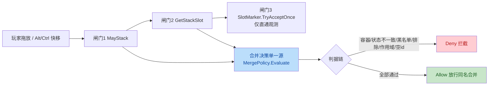
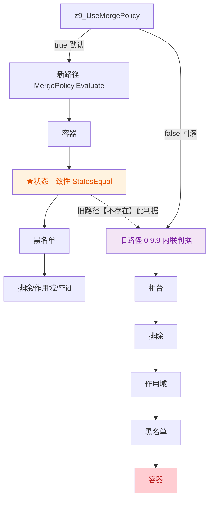

# Item Stacking 代码审查报告

- 审查对象：`Item stacking\ItemStacking\` 全部源文件（15 个 `.cs`，约 4500 行）
- 审查依据：`api优化建议.txt`（15 条 API 建议）+ 代码质量/正确性/可维护性/性能/最佳实践
- 审查基线：当前工作区代码（无 MR/分支差异）
- 审查方式：全量静态审查 + **2 个独立 Sub-Agent 并行交叉验证**（存在性 / 严重度 / 假阳性）
- 结论：**8 条候选问题 2/2 全票确认，无假阳性**；另确认 4 条附带发现

---

## 一、作者意图推断

> Intent：把三处重复的合并判据收敛为单一决策源（`MergePolicy.Evaluate`），并在此之上持续做「API 隔离」，以提升对游戏改版的抵抗力（把「静默失效」变成「启动自检告警」）。项目刻意保留 `z9_UseMergePolicy` 回滚开关做重构期 A/B 对照。

---

## 二、现状流程图

**① 合并决策业务流（三条挂点 → 单一决策源）**

**② 回滚开关分流（本次最重问题的技术细节）**

---

## 三、15 条优化建议核验结论

| # | 建议 | 现状 | 判定 |
|---|---|---|---|
| 1 | 私有字段直读 → Accessor | `StateConsistency.cs` 直读 `_state_k__BackingField` | ⚠️ 未做；**且未自检** → 见问题 2 |
| 2 | SameInventory/SameNativePtr 合并 | 两处重复 | ⚠️ 未做 → 见问题 5 |
| 3 | 探针 API 统一门控 | `GetMergeGateReason` 探针已门控；`Diag` 实参仍急切 | 🔶 部分 → 见问题 3 |
| 4 | 判据注册表 API | 硬编码 if-else | ✅ 维持否决（仅 6~9 条判据） |
| 5 | MergeContext 权威容器 | 单一 `slotInventory` | ✅ 已做 |
| 6 | Evaluate 结果缓存 | 无 | ✅ 维持否决（非纯函数） |
| 7 | 回滚路径接口化 | 开关 + 旧内联 | 🔶 未做（P3，等 1.0.0）；**但描述失实** → 见问题 1 |
| 8 | 名单覆盖泛型 API | 两套「默认+JSON+来源」 | 🔶 未做（历史建议，本轮不做，见 §六） |
| 9 | 容器 token 匹配独立 API | `MatchesContainerToken` 已抽 | 🔶 部分完成 |
| 10 | 拆堆-归还泛型化 | `SplitBeforeDestroy`+`ReturnRemainderAfter` | ✅ 等价达成 |
| 11 | 原生尾部复刻 API 化 | 已抽 `NativeTailCleanup`；**缺自检** | 🔶 部分 → 见问题 6 |
| 12 | 自检注册表 API | 顺序 40+ Check | 🔶 未做（历史建议，本轮不做，见 §六） |
| 13 | 版本号单一源 | 0.11.2 与注释 1.0.0 并存 | ⚠️ 未做 → 见问题 8 |
| 14 | FindAllChildItems 帧级缓存 | 每次深遍历 | ✅ 维持否决（语义风险） |
| 15 | MatchEmporiumSlot 快照缓存 | 已闭包外提；`IsCounterInventory` 未同步 | 🔶 部分 → 见问题 4 |

---

## 四、问题清单（交叉验证 2/2 全票）

| No. | 严重度 | 问题 | 建议 | 代码位置 |
|---|---|---|---|---|
| 1 | **major** | 回滚开关 `z9_UseMergePolicy=false` 会**连带绕过状态一致性闸门**（旧内联路径全程不调 `StatesEqual`），而 cfg 描述称「本项不影响功能行为」。用户按说明做 A/B 时会静默放行状态不同的物品合并，造成属性丢失 | 修正描述为「会改变功能行为」并明确警示 | [Main.cs#L265-L268](file:///d:/games/open%20code%20work/Item%20stacking/ItemStacking/Main.cs#L265-L268)、[Main.cs#L94-L98](file:///d:/games/open%20code%20work/Item%20stacking/ItemStacking/StackPatches.Merge.cs#L94-L98)、[MergePolicy.cs#L181-L183](file:///d:/games/open%20code%20work/Item%20stacking/ItemStacking/MergePolicy.cs#L181-L183) |
| 2 | medium | 状态闸门私有依赖（`_state_k__BackingField` / `TagSystem.dict` / `TagState` 7 字段）**未纳入启动自检**（仅查 `get_state`）。游戏改 backing 字段名 → `StatesEqual` 全异常 → Evaluate 判 Deny → **堆叠整体静默失效**，而自检仍报「通过」 | 补齐 `CheckMember` 自检 | [StateConsistency.cs#L151-L178](file:///d:/games/open%20code%20work/Item%20stacking/ItemStacking/StateConsistency.cs#L151-L178)、[StackPatches.cs#L137-L138](file:///d:/games/open%20code%20work/Item%20stacking/ItemStacking/StackPatches.cs#L137-L138) |
| 3 | medium | 热路径 `Diag($"...")` **实参急切求值**：`DiagOn=false` 时仍构造插值字符串并调 il2cpp getter（`identifier`）。`IsContainer` 每次决策被调 ≥2 次，与作者自身「探针外提」优化矛盾 | 热点调用点加 `if (DiagOn)` 守卫 | [Main.cs#L416-L419](file:///d:/games/open%20code%20work/Item%20stacking/ItemStacking/Main.cs#L416-L419)、[StackGates.cs#L53-L60](file:///d:/games/open%20code%20work/Item%20stacking/ItemStacking/StackGates.cs#L53-L60)、[StackPatches.Merge.cs#L58-L95](file:///d:/games/open%20code%20work/Item%20stacking/ItemStacking/StackPatches.Merge.cs#L58-L95) |
| 4 | low | `IsCounterInventory` 仍用 `TryGet(()=>entry.xxx)` 闭包，且与 `MatchEmporiumSlot` 的「直读」实现重复 → 热路径分配 + 双份实现漂移 | 统一为直读并复用同款写法 | [StackGates.cs#L803-L825](file:///d:/games/open%20code%20work/Item%20stacking/ItemStacking/StackGates.cs#L803-L825)、[StackGates.cs#L620-L647](file:///d:/games/open%20code%20work/Item%20stacking/ItemStacking/StackGates.cs#L620-L647) |
| 5 | low | `SameInventory`（专型）与 `SameNativePtr`（通用型）**两套指针比较重复**，null/零指针语义各异 | 合并为单一 null 安全 API | [StackGates.cs#L883-L895](file:///d:/games/open%20code%20work/Item%20stacking/ItemStacking/StackGates.cs#L883-L895)、[AltPairTransfer.cs#L320-L332](file:///d:/games/open%20code%20work/Item%20stacking/ItemStacking/AltPairTransfer.cs#L320-L332) |
| 6 | low | `NativeTailCleanup` 复刻的原生尾部契约（`ResetAfter` / `currentItem` / `isQuickTransfer` / `quickTransferKey`）**未纳入自检** → 游戏改名会静默失效（复现「再按 Alt 还搬」bug） | 补 `Check` / `CheckMember` | [AltPairTransfer.cs#L170-L199](file:///d:/games/open%20code%20work/Item%20stacking/ItemStacking/AltPairTransfer.cs#L170-L199)、[StackPatches.cs#L112-L117](file:///d:/games/open%20code%20work/Item%20stacking/ItemStacking/StackPatches.cs#L112-L117) |
| 7 | low | `AltPairMode` 用**区分大小写精确匹配**，填错静默退回原生，且启动时无「未知值」告警（cfg 已有文字提示，仅缺显式告警） | 启动时校验并告警 | [AltPairTransfer.cs#L86-L88](file:///d:/games/open%20code%20work/Item%20stacking/ItemStacking/AltPairTransfer.cs#L86-L88)、[Main.cs#L378-L382](file:///d:/games/open%20code%20work/Item%20stacking/ItemStacking/Main.cs#L378-L382) |
| 8 | low | 程序集版本 `0.11.2` 与代码/文案里的 `1.0.0` 并存，字面值在 3 处重复 | 版本号单一源 | [AssemblyInfo.cs#L5-L9](file:///d:/games/open%20code%20work/Item%20stacking/ItemStacking/AssemblyInfo.cs#L5-L9)、[Main.cs](file:///d:/games/open%20code%20work/Item%20stacking/ItemStacking/Main.cs) |

### 附带发现（同样 2/2 确认）

| No. | 严重度 | 问题 | 位置 |
|---|---|---|---|
| 9 | medium | 故障告警**分组误判**：`WarnOnceOnce` 以 key 子串判定保护/便利，`mp.fault.statecmp`（实际 `return Deny`）被判为「便利类·本次放行（不影响游玩）」→ 文案与行为相反，会误导维护者把数据保护故障当良性放行 | [MergePolicy.cs#L160-L169](file:///d:/games/open%20code%20work/Item%20stacking/ItemStacking/MergePolicy.cs#L160-L169)、[MergePolicy.cs#L116-L117](file:///d:/games/open%20code%20work/Item%20stacking/ItemStacking/MergePolicy.cs#L116-L117) |
| 10 | low | `TagStateEqual` 注释称 `valueFloat/valueDouble` 用「bit 级比较 / 字节完全相同」，实现却是 `!=`（数值比较：NaN 判不等、±0.0 判相等）→ **注释与实现不符** | [StateConsistency.cs#L206-L220](file:///d:/games/open%20code%20work/Item%20stacking/ItemStacking/StateConsistency.cs#L206-L220) |
| 11 | low | `MergePolicy` 头部「固定判定顺序」仍把**柜台列为步骤 1**（实际 0.11.0 已移交 `MergeSteerer`）；且宣称「三态」但 `Unknown` 从不返回 | [MergePolicy.cs#L24-L47](file:///d:/games/open%20code%20work/Item%20stacking/ItemStacking/MergePolicy.cs#L24-L47)、[MergePolicy.cs#L94-L98](file:///d:/games/open%20code%20work/Item%20stacking/ItemStacking/MergePolicy.cs#L94-L98) |
| 12 | low | 不可达死代码：`if (!AltTransferScope) return;` 位于同条件早退之后 | [StackPatches.AltTransfer.cs#L326-L342](file:///d:/games/open%20code%20work/Item%20stacking/ItemStacking/StackPatches.AltTransfer.cs#L326-L342) |

> 两个验证员均未发现崩溃/数据丢失级的额外缺陷；问题 1 是本次唯一达到 major 的正确性/安全回归。

---

## 五、修复计划与结果

| 问题 | 处置 | 状态 |
|---|---|---|
| 1 | 修正 cfg 描述 + 代码注释，明确「会改变功能行为、绕过状态闸门」（不改逻辑，保留作者 A/B 意图） | ✅ 已修复 |
| 2 | 补 `CheckMember` 自检 9 项 | ✅ 已修复 |
| 3 | `IsContainer` + `MayStack/GetStackSlot` 新路径热点 `Diag` 加 `if (DiagOn)` 守卫 | ✅ 已修复 |
| 4 | `IsCounterInventory` 改直读、去闭包 | ✅ 已修复 |
| 5 | 合并为 `SameNativePointer`，`SameInventory` 委托之，删除旧 `SameNativePtr` | ✅ 已修复 |
| 6 | 补尾部清理契约自检 4 项 | ✅ 已修复 |
| 7 | 启动时校验 `AltPairMode` 未知值并告警 | ✅ 已修复 |
| 8 | 版本号单一源 `Main.ModVersion` | ✅ 已修复 |
| 9 | `WarnOnceOnce` 改为显式 `protective` 参数（不再靠 key 子串猜） | ✅ 已修复 |
| 10 | 修正注释以如实描述 `!=` 语义（不改行为，避免未经实机验证的语义变更） | ✅ 已修复 |
| 11 | 修正 `MergePolicy` 头部顺序说明与三态说明 | ✅ 已修复 |
| 12 | 删除不可达行 | ✅ 已修复 |

### 本轮**不做**的历史建议（附理由）

- 建议 #8（名单覆盖泛型 `Overlay<T>`）、#12（自检注册表）属**架构级重构**，收益主要是「代码更整齐」，与项目「不做无必要架构重写、按优先级逐步落地」的既定偏好不符 → 维持现状态，留待后续批次。
- 建议 #4 / #6 / #14 维持既有否决结论（判据仅 6~9 条；`Evaluate` 非纯函数；`in` 只读结构体 + 语义风险）。

---

### 构建验证

- `dotnet build ItemStacking.csproj -c Release`：**0 警告 / 0 错误**，产物 `bin/Release/ItemStacking.dll`
- 行为等价性：除以下两处外均为等价重构/文档修正
  - 问题 5：指针相等判据统一后，非引用相等的两个包装对象要求 `Pointer != 0` 才判等（更严格，不会误判相等）
  - 问题 9：故障告警文案分组修正（`statecmp` 由「便利类·放行」纠正为「数据保护类·拦截」，与既有 `return Deny` 一致）

---

*报告生成：全量静态审查 + 双 Sub-Agent 交叉验证；所有问题均已附可跳转 `file:line` 证据。*